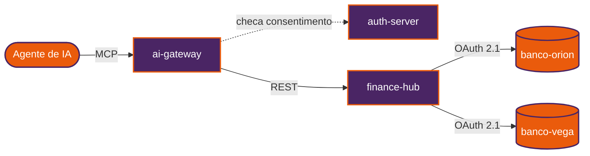

# openfinance-lab

Ecossistema de **Open Finance simulado**, construído com Java e Spring Boot: dois bancos fictícios, um servidor de autorização que controla o consentimento do cliente, um agregador financeiro e um assistente de IA que **só acessa dados com consentimento válido e sob auditoria**.

> Projeto de estudo e portfólio. Os bancos, clientes e valores são fictícios, e a infraestrutura regulatória do Open Finance real (FAPI, mTLS, diretório) é simplificada.


## Arquitetura



| Serviço | Papel | Status |
| --- | --- | --- |
| `banco-orion` | Banco fictício: contas, saldos e transações | Em construção |
| `banco-vega` | Segundo banco fictício | Planejado |
| `auth-server` | OAuth 2.1, login e consentimento | Planejado |
| `finance-hub` | Agrega os dados dos dois bancos | Planejado |
| `ai-gateway` | Governança dos agentes de IA: consentimento, limites e auditoria | Planejado |
| `finance-assistant` | Assistente financeiro com Spring AI | Planejado |

## Como rodar

**Pré-requisitos:** Java 25 e Git. O Maven não precisa ser instalado: o projeto usa o Maven Wrapper (`mvnw`).

```bash
git clone https://github.com/vitoralemaorb/openfinance-lab.git
cd openfinance-lab

./mvnw verify                                              # compila e roda os testes
java -jar banco-orion/target/banco-orion-0.1.0-SNAPSHOT.jar  # sobe o banco-orion
```

Com o serviço no ar, `http://localhost:8080/actuator/health` deve responder `{"status":"UP"}`.

No Windows, sem Git Bash, use `mvnw.cmd verify`.

## Estrutura

```
openfinance-lab/
├── pom.xml          ← POM pai: Spring Boot, Java e versão do projeto
├── mvnw, .mvn/      ← Maven Wrapper
├── banco-orion/     ← primeiro serviço
├── docs/            ← documentação do projeto
└── .github/         ← template de Pull Request
```

Cada serviço é um módulo Maven que herda do `pom.xml` da raiz, que por sua vez herda do `spring-boot-starter-parent`.

## Roadmap

- [ ] **Fase 0 · Fundações**: monorepo Maven, Docker Compose e fluxo de PRs *(em andamento)*
- [ ] **Fase 1 · Bancos e consentimento**: APIs bancárias e OAuth 2.1 com consentimento
- [ ] **Fase 2 · Sistema distribuído**: agregador, eventos com Kafka, observabilidade e CI
- [ ] **Fase 3 · IA governada**: assistente com Spring AI e MCP, limites e auditoria
- [ ] **Fase 4 · Cloud**: deploy e demo pública

## Como contribuir

O fluxo de trabalho (branches, commits, Pull Requests e versionamento) está em [`docs/VERSIONAMENTO.md`](docs/VERSIONAMENTO.md).

## Autor

**Vítor Hugo** · [LinkedIn](https://www.linkedin.com/in/vitoralemao) · [GitHub](https://github.com/vitoralemaorb)
